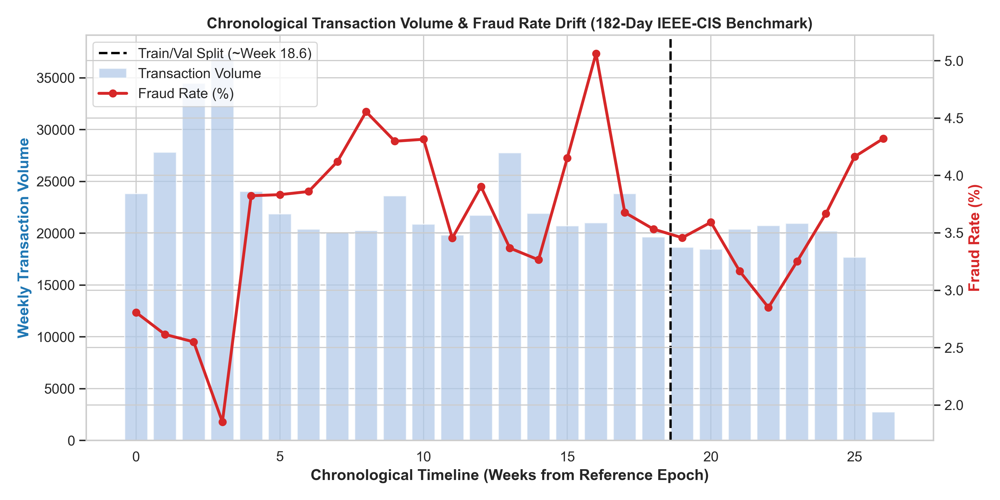
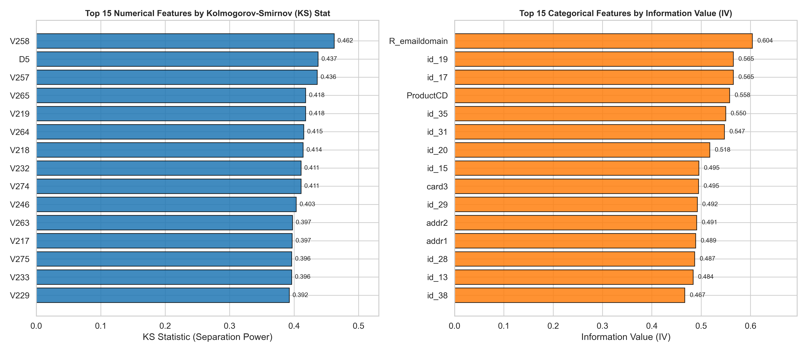
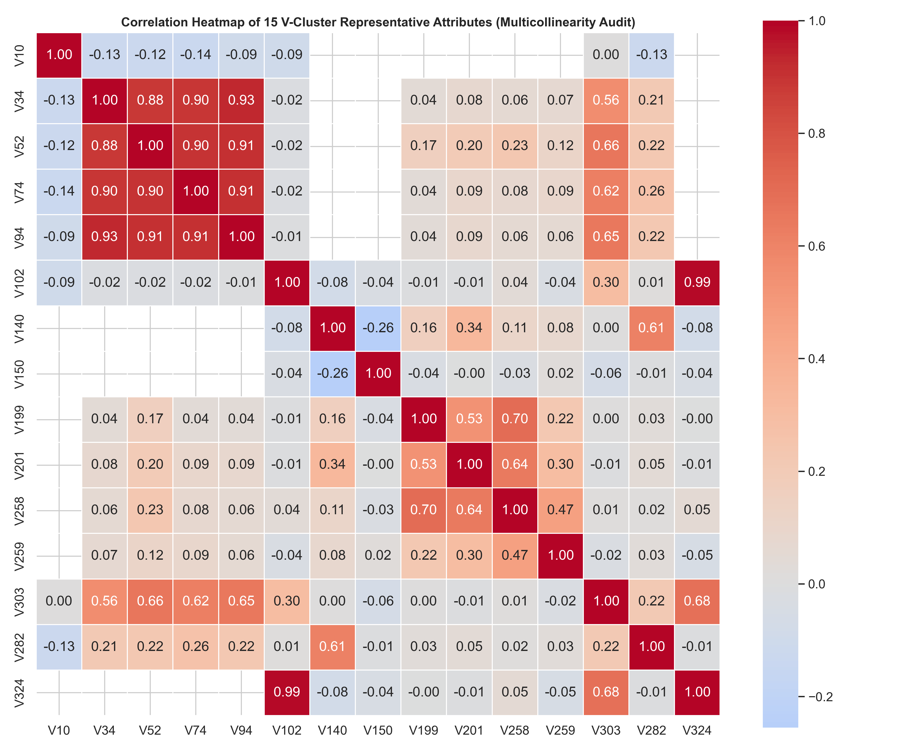

# 🛡️ An Empirical Investigation & Deep Learning Tabular Architecture for Fraud Detection

[](https://www.python.org/)
[](https://pytorch.org/)
[](https://www.uit.edu.vn/)
[](https://www.kaggle.com/c/ieee-fraud-detection)

**Author:** Dinh Pham Anh Quan (Student ID: 24521425)  
**Faculty:** Faculty of Information Science and Engineering, University of Information Technology (UIT), VNU-HCM  
**Course:** DS201 — Deep Learning in Data Science  
**Instructor:** Faculty of Information Science and Engineering  

---

## 📌 Executive Summary & Research Motivation

Financial fraud detection on e-commerce transaction streams presents extreme challenges:
1. **Severe Class Imbalance:** Fraudulent transactions account for only **~3.50%** of total observations.
2. **Extreme Heterogeneity & Missingness:** Raw data joins high-volume transactional logs (590,540 rows) with sparsely observed client device telemetry (only **24.42%** populated). Over 47.9% of attributes suffer from $>70\%$ missingness.
3. **Severe Multicollinearity:** 339 anonymized Vesta-engineered features ($V1-V339$) introduce severe dimension redundancy and gradient divergence in neural models.
4. **Chronological Concept Drift:** Transaction dynamics shift over time, rendering naive random $K$-Fold cross-validation vulnerable to severe future look-ahead data leakage.

This project delivers an end-to-end, leakage-free empirical investigation and deep tabular neural network pipeline on the **IEEE-CIS Fraud Detection Benchmark**.

---

## 🔬 Core Empirical Contributions & Breakthroughs

1. **49 Official Categorical Entities Resolved:**
   - Heuristics identify only 31 text columns. We uncover **18 numerical-encoded categorical columns** (e.g., $card1-card5$, $addr1, addr2$, $id\_13-id\_26, id\_32$) that must strictly be mapped through **Entity Embedding** layers ($d_i = \min(50, \lfloor \sqrt{K_i}/2 \rfloor + 2)$) to prevent false linear ordering.
2. **Reverse-Engineering Obfuscated Hardware Telemetry:**
   - $id\_14$ acts as a discrete 60-minute client timezone offset exposing geographic discrepancies.
   - $id\_32$ reveals display color depth, isolating headless automated fraud bot attacks (depth $= 0.0$).
3. **Non-Parametric Statistical Separation:**
   - **Kolmogorov-Smirnov ($D_{\text{KS}}$):** Evaluated over 382 numerical features. Top separation features: `V258` ($D_{\text{KS}}=0.4621$), `D5` ($0.4371$), `V257` ($0.4360$), `V265` ($0.4179$).
   - **Information Value (IV):** Evaluated over 49 categorical features. Top predictors: `R_emaildomain` ($0.6036$), `id_19` ($0.5652$), `id_17` ($0.5652$), `ProductCD` ($0.5576$).
4. **15-Cluster Null-Pattern Decomposition of 339 V-Features:**
   - Decomposes 339 collinear $V$-attributes into exactly 15 null-mask clusters.
   - **Strategy A (V15):** Compresses to 15 elite cluster representatives.
   - **Strategy B (VPCA):** Preserves $>85\%$ variance using cluster-wise PCA (45 orthogonal components).
5. **Leakage-Free Temporal Validation Topology:**
   - Chronological partition at $TransactionDT = 11,246,665$:
     - **Train:** 442,905 transactions ($75.00\%$)
     - **Validation:** 147,635 transactions ($25.00\%$)
     - **Test:** 506,691 transactions

---

## 📊 Diagnostic Visualizations

| Chronological Concept Drift | Feature Predictive Power (KS & IV) |
| :---: | :---: |
|  |  |

| V-Cluster Multicollinearity Heatmap |
| :---: |
|  |

---

## 📁 Repository Structure

```text
├── data/
│   ├── raw/ieee-fraud-detection/      # Raw Kaggle CSVs (git-ignored)
│   └── processed/                     # High-performance Parquet datasets & metadata
│       ├── train_v15.parquet          # 442,905 rows, 110 columns (24.7 MB)
│       ├── val_v15.parquet            # 147,635 rows, 110 columns (8.4 MB)
│       ├── test_v15.parquet           # 506,691 rows, 109 columns (28.7 MB)
│       ├── train_vpca.parquet         # 442,905 rows, 140 columns (48.1 MB)
│       ├── val_vpca.parquet           # 147,635 rows, 140 columns (16.7 MB)
│       ├── test_vpca.parquet          # 506,691 rows, 139 columns (57.5 MB)
│       ├── label_encoders.pkl         # 49-feature dictionary encoders
│       ├── scaler_v15.pkl & scaler_vpca.pkl
│       └── metadata_v15.json & metadata_vpca.json
├── eda/
│   ├── 04_data_mining_contrast.py     # Non-parametric statistical contrast & PCA
│   ├── inspect_categories.py          # Value auditor for official 49 categoricals
│   └── scan_anomalies.py              # Sentinel, clock-drift & null auditor
├── outputs/
│   ├── figures/                       # Publication-grade PNG charts
│   ├── ks_test_results.csv            # 382 numerical features ranked by KS stat
│   ├── iv_results.csv                 # 49 categorical features ranked by IV
│   ├── v_clusters_summary.csv         # 15 V-clusters summary table
│   ├── v_cluster_config.json          # V-cluster feature map
│   ├── v_pca_dimensions.json          # Components per cluster
│   └── v_pca_transformers.pkl         # Cluster-wise PCA transformers
├── report/
│   └── main.tex                       # IEEE Conference LaTeX paper
├── src/
│   ├── config.py                      # Centralized Single Source of Truth
│   ├── preprocess.py                  # High-speed vectorized Parquet pipeline
│   ├── dataset.py                     # PyTorch Dataset & DataLoader
│   ├── losses.py                      # BinaryFocalLoss & WeightedBCELoss
│   ├── models.py                      # TabularEntityEmbeddingNN & Baselines
│   ├── train.py                       # Training loop, Early Stopping & Schedulers
│   ├── evaluate.py                    # ROC-AUC, PR-AUC & optimal threshold tuning
│   └── run_experiments.py             # Benchmark ablation experiment runner
├── .gitignore                         # Configured to protect against bulky raw CSVs
├── requirements.txt                   # Dependency environment specification
└── README.md                          # Comprehensive project documentation
```

---

## ⚙️ Quickstart & Reproduction

### 1. Environment Setup
```bash
# Clone the repository
git clone https://github.com/Quandinh030106/ieee-cis-fraud-detection-deep-learning.git
cd ieee-cis-fraud-detection-deep-learning

# Install dependencies
pip install -r requirements.txt
```

### 2. Data Mining & Statistical Contrast
```bash
python eda/04_data_mining_contrast.py
```
*Outputs: `outputs/ks_test_results.csv`, `outputs/iv_results.csv`, `outputs/v_clusters_summary.csv`, and all figures in `outputs/figures/`.*

### 3. High-Performance Preprocessing Pipeline
```bash
python src/preprocess.py
```
*Outputs: `train_v15.parquet`, `val_v15.parquet`, `test_v15.parquet`, `train_vpca.parquet`, `val_vpca.parquet`, `test_vpca.parquet`, scalers, and encoders in `data/processed/`.*

### 4. Run Deep Learning Benchmarks & Ablation Studies
```bash
python src/run_experiments.py
```

---

## 📜 Scientific Paper
The complete manuscript is authored in LaTeX using the standard IEEE Conference format at [`report/main.tex`](report/main.tex), containing formal mathematical formulations, empirical missingness topology, and benchmark results.

---

## ⚖️ License & Acknowledgements
- **Benchmark Dataset:** [IEEE Computational Intelligence Society (IEEE-CIS) Fraud Detection](https://www.kaggle.com/c/ieee-fraud-detection), organized in partnership with Vesta Corporation.
- Developed as part of coursework **DS201 - Deep Learning in Data Science** at University of Information Technology (UIT), VNU-HCM.
